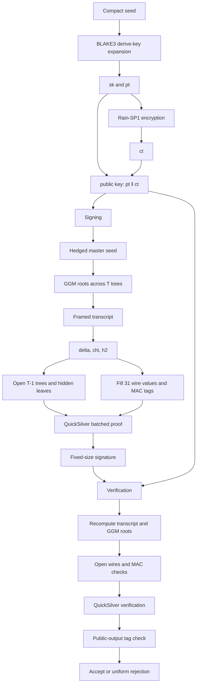

<div align="center">

# VORB3-SP1

**A compact, `no_std`, post-quantum signature library built from Rain-SP1, GGM vector commitments, and QuickSilver.**

[](LICENSE)
[](rust-toolchain.toml)
[](#no_std-and-embedded-use)
[](#dependency-policy)
[](#safety-invariants)
[](#security-status)

</div>

> [!WARNING]
> VORB3-SP1 is a locally verified cryptographic implementation, **not an
> externally audited or certified product**. Do not deploy it where a
> compromise would be unacceptable without independent cryptographic,
> implementation, and side-channel review. The evidence in this repository is
> local evidence; it is not a security certificate.

---

## Contents

- [Papers](#papers)
- [Overview](#overview)
- [Profiles](#profiles)
- [Design](#design)
- [Signature anatomy](#signature-anatomy)
- [Security status](#security-status)
- [Assurance evidence](#assurance-evidence)
- [Performance](#performance)
- [Quick start](#quick-start)
- [No_std and embedded use](#no_std-and-embedded-use)
- [Repository layout](#repository-layout)
- [Reproducing the evidence](#reproducing-the-evidence)
- [Release history](#release-history)
- [Documentation](#documentation)
- [Limitations and open work](#limitations-and-open-work)
- [Security reporting](#security-reporting)
- [License](#license)

---

## Papers

Long-form companion documents are included in the repository:

- [Academic white paper (PDF)](docs/papers/VORB3-SP1-Whitepaper.pdf) /
  [LaTeX source](docs/papers/VORB3-SP1-Whitepaper.tex) — design, security
  argument, implementation, evaluation, and limitations.
- [Yellow paper (PDF)](docs/papers/VORB3-SP1-Yellow-Paper.pdf) /
  [LaTeX source](docs/papers/VORB3-SP1-Yellow-Paper.tex) — formal protocol,
  algorithms, wire format, domain separation, and test-vector manifest.

## Overview

VORB3-SP1 is a Rust implementation of a VOLEitH/QuickSilver-style
post-quantum signature scheme. It combines:

- **Rain-SP1** — an inversion-based one-way function with field-linear
  diffusion and 15 rounds;
- **GGM/Merkle commitments** — 35 trees for the frozen default profile, or the
  32-tree protocol minimum for the compact packs;
- **QuickSilver** — a batched multiplication proof over 60 gates, using 31
  secret wires plus one mask leaf;
- **WH512** — a 64-byte wide BLAKE3 construction for commitments, Merkle
  nodes, salts, challenges, and transcript binding.

The shipped library is deliberately small and portable:

| Property | Value |
|---|---|
| Language | Rust 2024, MSRV **1.99.0** |
| Runtime | `no_std`, no allocator, no heap |
| Unsafe code | **forbidden** (`forbid(unsafe_code)`) |
| Runtime dependencies | **zero** third-party crates |
| Default profile | SP-288/35, 13,672-byte signatures |
| Compact profiles | SP-160/32 and SP-224/32 |
| Build-time code generation | none |
| License | **GPL-3.0-or-later** |

The project includes an independent Python reference model, frozen known-answer
tests, differential vectors, a negative-test suite, fuzzing harnesses, a
constant-time measurement harness, and reproducible local gates. The Rust and
Python implementations are cross-checked byte for byte.

> **Design intent:** make a compact signature practical on constrained targets
> without hiding the assurance burden. Every claim is either tested, proved in a
> bounded model, or explicitly listed as an assumption or open limitation.

---

## Profiles

The protocol equations are shared. A profile changes the field, tree count,
element sizes, and signature length; every profile has its own frozen KATs.

| Feature | Profile | Field | Trees | Rounds | Signature | Public key | Seed | Conservative floor |
|---|---|---|---:|---:|---:|---:|---:|---:|
| *(default)* | **SP-288/35** | GF(2^288) | 35 | 15 | **13,672 B** | 72 B | 36 B | ≈140-bit quantum / 256-bit classical |
| `nist1` | **NIST Level 1+** (SP-160/32) | GF(2^160) | 32 | 15 | **7,976 B** | 40 B | 20 B | ≈76.5-bit quantum / 153-bit classical |
| `nist3` | **NIST Level 3+** (SP-224/32) | GF(2^224) | 32 | 15 | **10,296 B** | 56 B | 28 B | ≈108.5-bit quantum / 217-bit classical |
| `bench-api` | Measurement API | — | — | — | — | — | — | Internal; not a stable API |

`nist1` and `nist3` are **mutually exclusive**. Enabling both is a deliberate
`compile_error!`. Use one profile feature at a time; `--all-features` is not a
valid build for this crate.

The “+” labels indicate that the conservative floor is above the nominal NIST
category. They are **not** NIST certifications or formal NIST conformance
claims.

### Why 32 trees?

The circuit has 31 secret wires (`sk`, 15 `y` values, 15 `b` values) plus one
mask leaf. The GGM vector commitment therefore needs at least 32 trees for the
15-round protocol. Smaller tree counts would require reducing the round count,
which is not accepted. The compact packs keep 32 trees and vary the field
instead.

---

## Design

### Protocol flow



### Rain-SP1

Rain-SP1 is a 15-round inversion-based permutation with a public per-round
field multiplier. The zero-safe inversion gadget uses two secret wires per
round, giving the 31-wire budget. The design intentionally avoids a binary MDS
matrix that a field-VOLE verifier cannot apply to its MAC shares.

### GGM / Merkle vector commitment

Each tree is a depth-8 GGM tree with 256 leaves. One leaf per tree is hidden;
the signer opens the other 255 leaves and supplies the copath. The verifier
reconstructs each root from the opened leaf and copath. The hidden leaves carry
the VOLE correlations; the dedicated mask tree supplies the independent
one-time-pad material for the batched proof.

### QuickSilver

QuickSilver batches 60 multiplication gates (four per round). The prover
supplies masked values `(U, V)` and a public-output tag; the verifier checks the
wire MAC equations and the batched product relation. All invalid signature
content collapses to one uniform `InvalidSignature` result.

### WH512 and BLAKE3

WH512 is a 64-byte commitment built from two independent BLAKE3-256 domain
instances. BLAKE3-256 alone has a 256-bit chaining state; WH512 is used where a
wider classical/quantum collision margin is required. BLAKE3 is also used for
`derive_key` expansion, keyed hashing, and the streaming transcript.

### Transcript

The transcript is length-framed, domain-separated, and ratcheted. It absorbs the
public key, salt, message, and all tree roots, then squeezes the challenge
material. Signature bytes are bound by one of: transcript absorption, Merkle
root reconstruction, a wire/MAC equation, the QuickSilver mask check, or the
public-output check. There is no unbound padding.

### Safety invariants

- `#![no_std]`, no allocator, no heap.
- `#![forbid(unsafe_code)]`.
- Zero third-party runtime dependencies; no `build.rs`.
- Fixed iteration counts and masked selection in secret-bearing operations.
- No secret-dependent indexing or early exit on secret material.
- Best-effort zeroization of owned secret buffers on drop and on explicit wipe.
- Compile-time fixed signature, public-key, and seed lengths.
- Uniform verification failure for all signature-content errors.
- Lints deny panic, unwrap, expect, indexing/slicing, `as` conversions,
  arithmetic side effects, float arithmetic, and missing docs.

---

## Signature anatomy

All values are fixed-size. `F` is the field width in bytes and `T` is the tree
count.

| Component | SP-288/35 | L1+ | L3+ | Purpose |
|---|---:|---:|---:|---|
| `salt` | 64 | 64 | 64 | Transcript and GGM domain separation |
| `h2` | 64 | 64 | 64 | Bound challenge digest |
| `wire_d[31]` | 1,116 | 620 | 868 | Masked wire responses |
| `U` | 36 | 20 | 28 | Batched proof value |
| `V` | 36 | 20 | 28 | Batched proof value |
| `out_tag` | 36 | 20 | 28 | Public-output MAC tag |
| `copaths[T][8]` | 10,080 | 5,120 | 7,168 | Merkle authentication paths |
| `hidden_coms[T]` | 2,240 | 2,048 | 2,048 | Hidden-leaf commitments |
| **Total** | **13,672** | **7,976** | **10,296** | Exact length, no trailing bytes |

The byte-level layout is specified in
[`docs/WIRE-BINDING.md`](docs/WIRE-BINDING.md). Every byte is accounted for.

---

## Security status

### Design targets

| Property | Target |
|---|---|
| SUF-CMA | 128-bit quantum / 256-bit classical floor |
| Key recovery | 128-bit quantum / 256-bit classical floor |
| Fiat–Shamir soundness | 128-bit quantum |
| Field-check soundness | 128-bit quantum |
| Hash collision | 128-bit quantum |
| PRF/GGM | 128-bit quantum |
| Zero knowledge | Statistical, with a documented budget |
| Side channels | Evidence-based, not a formal theorem |

### Conservative profile accounting

The table uses the project’s conservative QuickSilver union bound
`G · 2 / |F|` with `G = 60` gates. It is a floor, not a proof of the full
scheme.

| Profile | Field check (q/c) | Tree challenge (q/c) | Key (q/c) | WH512 (q/c) | Overall floor | Signature |
|---|---:|---:|---:|---:|---:|---:|
| SP-288/35 | 140.5 / 281.1 | 140 / 280 | 144 / 288 | 170 / 256 | **≈140 / 256** | 13,672 B |
| SP-160/32 | 76.5 / 153.1 | 128 / 256 | 80 / 160 | 170 / 256 | **≈76.5 / 153.1** | 7,976 B |
| SP-224/32 | 108.5 / 217.1 | 128 / 256 | 112 / 224 | 170 / 256 | **≈108.5 / 217.1** | 10,296 B |

The 256-bit field profile is **not** used for a 128-bit claim: under the same
accounting it is approximately 125-bit quantum. The frozen default profile is
SP-288/35 at ≈140-bit quantum.

### What this repository does and does not claim

| Claim | Status |
|---|---|
| Frozen wire format and KATs | **Yes** |
| Byte-identical Rust/Python model differential | **Yes** |
| Bounded Kani helper proofs | **Yes** — 18/18 default, 16/16 per compact pack |
| Full symbolic Kani proof of sign/verify | **No** — open limitation |
| Formal Rain-SP1 cryptanalytic proof | **No** — local dossier only |
| ASan, Miri, memcheck, careful-mode checks | **Yes** — local |
| Constant-time evidence (`dudect`, ctgrind, cachegrind, assembly) | **Yes** — evidence, not proof |
| 72-hour / 1-billion-execution fuzz soak | **Deferred** |
| Apple runtime execution | **Not covered locally** |
| External audit | **None** |
| NIST/FIPS certification | **None** |
| Production readiness | **Not claimed** |

---

## Assurance evidence

The default SP-288/35 profile is the frozen v1.0.0 baseline. The compact packs
were introduced in v1.1.0/v1.2.0 and optimized in v1.3.0. The newest local
campaign re-ran the compact-pack gates after the field optimization.

### Frozen KATs

| Profile | Signature KAT SHA-256 |
|---|---|
| SP-288/35 | `c073c7e3f7b31192ba1932f9ed990b32bc4f321453347a23837803ef4fa9b68b` |
| SP-160/32 | `43dcf2de9720219ff5c228e7f777e59fb3b3f8b8aa62cf7819c30b1d4a55be80` |
| SP-224/32 | `3ad501e141327a2844641096b98cb074164f5ac0aa93ef6a3d96d0a14034fc49` |

### Campaign summary

| Check | SP-288/35 (v1.0.0) | Level 1+ (v1.3.0) | Level 3+ (v1.3.0) |
|---|---|---|---|
| Model KAT + signature differential | pass | pass | pass |
| Field differential | 512 vectors | 4,096 records | 4,096 records |
| Structured envelope/swap/replay attacks | pass | pass | pass |
| Single-bit signature sweep | 109,376 rejected | 63,808 rejected | 82,368 rejected |
| libFuzzer campaign | 405,581,569 execs, 0 crashes | 12,310,692 execs, 0 crashes | 24,575,666 execs, 0 crashes |
| Targeted mutation | 494 mutants | 427 mutants | 427 mutants |
| Mutation outcome | 371 caught, 27 Z3 equivalents + 3 Drop, 84 unviable, 9 timeouts | 335 caught, 29 missed, 53 unviable, 10 timeouts | 335 caught, 29 missed, 53 unviable, 10 timeouts |
| Kani helpers | 18/18 | 16/16 | 16/16 |
| ASan full graph | pass | pass | pass |
| Miri | full sign+verify KAT, CT, zeroization, field, keys, signature | field + keys, strict provenance | field + keys, strict provenance |
| Coverage | 100% functions / 99.90% lines | 100% functions / 99.70% lines | 100% functions / 99.70% lines |
| 32 KiB release stack | pass | pass | pass |
| Cross-runtime | AArch64, s390x, i686, ppc64, Windows, WASI | same | same |
| dudect 50k | sign `t=-1.383`, verify `t=0.552` | sign `t=-0.317`, verify `t=-0.468` | sign `t=1.460`, verify `t=0.977` |
| Reproducible rlib | `60e98d9c…` twice | `bc245cdb…bd0d` twice | `cf198c13…d20b` twice |

The compact-pack mutation misses are 26 expression-equivalent mutants covered
by 21 Z3-checked equivalence classes plus three unobservable `Drop` wipes.
The full reports are in
[`docs/REDTEAM-CAMPAIGN.md`](docs/REDTEAM-CAMPAIGN.md),
[`docs/COVERAGE.md`](docs/COVERAGE.md),
[`docs/SIDE-CHANNEL.md`](docs/SIDE-CHANNEL.md), and
[`docs/ASSURANCE.md`](docs/ASSURANCE.md).

### What “local evidence” means

The evidence was produced on the project’s local build host with pinned
toolchains and checked-in scripts. It demonstrates that the tested properties
held for the tested inputs and configurations. It does not replace independent
review, formal verification of the full scheme, or hardware side-channel
measurement.

---

## Performance

Release build, 25 samples per operation. The compact packs use the optimized
field arithmetic introduced in v1.3.0.

| Operation | SP-288/35 | Level 1+ | Level 3+ |
|---|---:|---:|---:|
| Key generation | 266.1 µs | **74.2 µs** | **151.8 µs** |
| Sign, 32 B | 6.364 ms | **4.855 ms** | **5.105 ms** |
| Verify, 32 B | 5.676 ms | **4.639 ms** | **4.648 ms** |
| Sign + verify, 32 B | 12.007 ms | **9.501 ms** | **9.834 ms** |
| Rain-SP1 encryption | 257.9 µs | **69.4 µs** | **146.7 µs** |
| Field multiplication | 712 ns | **216 ns** | **409 ns** |
| Field squaring | 13.4 ns | **10.5 ns** | **11.8 ns** |
| Field inversion | 17.36 µs | **4.43 µs** | **9.40 µs** |

At 16 MiB, signing costs roughly 3.1 ms/MiB and verification about 2.1 ms/MiB
across the profiles. GGM/BLAKE3 root derivation is now the dominant signing
cost.

Full tables, phase breakdowns, and message-size scaling:
[`docs/NIST-BENCHMARKS.md`](docs/NIST-BENCHMARKS.md) and
[`docs/BENCHMARKS.md`](docs/BENCHMARKS.md).

> Benchmarks are machine- and compiler-dependent. They are not a security
> claim, and throughput does not imply constant-time behavior.

---

## Quick start

### Prerequisites

- Rust **1.99.0** (the repository pins it in `rust-toolchain.toml`)
- Nightly Rust for `cargo fuzz`, Miri, and some deep checks
- Kani for the formal helper proofs
- Optional: QEMU, Wine, wasmtime, Valgrind for the extended local gates

### Build and test

```bash
# Default SP-288/35 profile
cargo build --release -p vorb3
cargo test -p vorb3

# Compact profiles
cargo test -p vorb3 --features nist1
cargo test -p vorb3 --features nist3

# Explicitly invalid: nist1 and nist3 are mutually exclusive
# cargo test --all-features
```

The full local gate includes formatting, clippy with deny-level lints, tests,
the 32 KiB release stack target, a release build, a bare-metal `thumbv7em`
build, and a zero-dependency proof:

```bash
./scripts/gate.sh
VORB3_FEATURES=nist1 ./scripts/gate.sh
VORB3_FEATURES=nist3 ./scripts/gate.sh
```

### Sign and verify

```rust
use vorb3::keys::{Error, ExpandedSecretKey, SecretKey};
use vorb3::sign::{sign, verify};
use vorb3::FIELD_BYTES;

fn sign_and_verify(message: &[u8], entropy: &[u8; 32]) -> Result<(), Error> {
    // Test-only seed. In production, generate the seed with a CSPRNG and
    // protect it as a long-term secret.
    let seed = [0x42u8; FIELD_BYTES];
    let compact = SecretKey::from_seed(seed);
    let expanded = ExpandedSecretKey::from_seed(&compact);
    let public = expanded.public_key()?;
    let signature = sign(message, &expanded, entropy)?;

    verify(message, &public, &signature)?;
    Ok(())
}
```

`entropy` is 32 bytes supplied by the caller. Use a cryptographically secure
random source in production; the all-zero value is a test/KAT input.

For fixed buffers and to avoid returning a large signature by value:

```rust
use vorb3::keys::{Error, ExpandedSecretKey, SecretKey};
use vorb3::sign::{sign_into, verify_bytes};
use vorb3::{FIELD_BYTES, SIGNATURE_LEN};

fn sign_into_buffer(message: &[u8], entropy: &[u8; 32]) -> Result<(), Error> {
    let compact = SecretKey::from_seed([0x42u8; FIELD_BYTES]);
    let expanded = ExpandedSecretKey::from_seed(&compact);
    let public = expanded.public_key()?;

    let mut signature = [0u8; SIGNATURE_LEN];
    sign_into(message, &expanded, entropy, &mut signature)?;
    verify_bytes(message, &public, &signature)?;
    Ok(())
}
```

The signature is large by design: see the profile table. If you place it on the
stack, budget the corresponding stack space; `sign_into` only avoids the return
copy.

### Feature selection

```bash
# Default frozen SP-288/35
cargo build -p vorb3

# NIST Level 1+ (SP-160/32)
cargo build -p vorb3 --features nist1

# NIST Level 3+ (SP-224/32)
cargo build -p vorb3 --features nist3
```

The selected feature changes the public constants:

```rust
use vorb3::{FIELD_BITS, FIELD_BYTES, PUBLIC_KEY_LEN, SIGNATURE_LEN, SPEC_VERSION};
```

---

## No_std and embedded use

The library itself is `#![no_std]`, allocates no heap, and has no runtime
dependencies. A dependent crate can disable default features (there are none
today, but this keeps the intent explicit):

```toml
[dependencies]
vorb3 = { path = "path/to/VORB3/vorb3", default-features = false }

# Or select one compact pack:
# vorb3 = { path = "path/to/VORB3/vorb3", default-features = false, features = ["nist1"] }
```

The 32 KiB stack target covers the library’s internal working set in release
mode. If the caller places the entire signature buffer on the stack, budget the
larger 64 KiB case for the default profile. Compact profiles have smaller
signatures; the checked-in `nist_stack` tests still exercise the 32 KiB
internal target and the output-on-stack case.

### Dependency policy

- No third-party runtime crates.
- No `alloc`.
- No `build.rs` code generation.
- No network or filesystem access in the library.
- The Python model and Rust tools are development-only and are not linked into
  the shipped crate.

---

## Repository layout

```text
.
├── vorb3/                 Shipped no_std Rust library
│   ├── src/               Field, Rain-SP1, BLAKE3/WH512, GGM, QuickSilver,
│   │                      transcript, keys, sign/verify, signature
│   └── tests/             KATs, differentials, attacks, stack, bench API
├── model/                 Independent Python reference model
├── kat/                   Frozen KATs and differential vectors
├── fuzz/                  cargo-fuzz workspace
├── tools/
│   ├── attack/            Bit-flip, stress, dudect, benchmark harness
│   ├── bench/             Full benchmark suite
│   └── ctgrind/           Valgrind C-ABI harness
├── scripts/               Local gates, fuzz, mutation, cross-runtime,
│                          coverage, SBOM, reproducibility, benchmark reports
├── docs/                  Specification, threat model, assurance, evidence,
│                          releases, benchmarks, NIST packs
├── LICENSE                GNU GPL v3.0
└── README.md
```

The master plan and drafting notes are kept local; historical phase reports
remain under `docs/` for traceability.

---

## Reproducing the evidence

The scripts are intentionally local, deterministic where possible, and do not
require network access after toolchain installation.

| Gate | Command |
|---|---|
| Default local gate | `./scripts/gate.sh` |
| Level 1+ gate | `./scripts/nist-gate.sh nist1` |
| Level 3+ gate | `./scripts/nist-gate.sh nist3` |
| Deep formal/Miri gate | `./scripts/gate-deep.sh` |
| Fuzz campaign | `FUZZ_FEATURES=nist1 FUZZ_TAG=n1 ./scripts/fuzz-campaign.sh 300` |
| Mutation equivalences | `python3 scripts/verify_mutation_equivalences.py` |
| Cross-runtime | `VORB3_FEATURES=nist1 ./scripts/cross-runtime.sh` |
| Portable runtime | `VORB3_FEATURES=nist3 ./scripts/portable-runtime.sh` |
| WASI runtime | `VORB3_FEATURES=nist3 ./scripts/wasm-runtime.sh` |
| Reproducible rlib | `VORB3_FEATURES=nist1 ./scripts/reproducible.sh` |
| Full benchmarks | `VORB3_FEATURES=nist3 BENCH_CPU=4 ./scripts/bench.sh` |
| Red-team umbrella | `./scripts/redteam.sh --all` |

The raw evidence is written under `target/` and
`/tmp/opencode/`; the curated reports are checked in under `docs/`.
The 72-hour fuzz soak and external audit are deliberately not run by default.

---

## Release history

| Tag | Release | Summary |
|---|---|---|
| `v1.0.0` | SP-288/35 | Frozen default profile: 13,672-byte signatures, ~140-bit quantum floor |
| `v1.1.0` | NIST Level 1+ | SP-160/32, 7,976-byte signatures |
| `v1.2.0` | NIST Level 3+ | SP-224/32, 10,296-byte signatures |
| `v1.3.0` | Compact-field performance | Bit-interleaved squaring, word-level reduction, Itoh–Tsujii inversion; both compact packs now faster to sign and verify than the baseline |

The frozen KATs do not change across the compact-pack optimization. Full
release notes and hashes are in [`docs/RELEASES.md`](docs/RELEASES.md).

---

## Documentation

| Document | Purpose |
|---|---|
| [`docs/papers/VORB3-SP1-Whitepaper.pdf`](docs/papers/VORB3-SP1-Whitepaper.pdf) | Academic white paper (PDF) |
| [`docs/papers/VORB3-SP1-Yellow-Paper.pdf`](docs/papers/VORB3-SP1-Yellow-Paper.pdf) | Formal yellow paper (PDF) |
| [`docs/VORB3-SPEC-1.md`](docs/VORB3-SPEC-1.md) | Frozen protocol, equations, and wire specification |
| [`docs/WIRE-BINDING.md`](docs/WIRE-BINDING.md) | Byte-by-byte signature binding table |
| [`docs/THREAT-MODEL.md`](docs/THREAT-MODEL.md) | Assets, adversaries, trust boundaries |
| [`docs/SECURITY-CASE.md`](docs/SECURITY-CASE.md) | Security target, F-33 union bound, assumptions |
| [`docs/ASSURANCE.md`](docs/ASSURANCE.md) | Requirement-to-evidence matrix |
| [`docs/DECISIONS.md`](docs/DECISIONS.md) | Architecture decisions D1–D26 and findings F-01–F-33 |
| [`docs/RELEASES.md`](docs/RELEASES.md) | Release surfaces, KAT hashes, evidence |
| [`docs/NIST-PACKS.md`](docs/NIST-PACKS.md) | NIST-tier parameter packs and evidence |
| [`docs/NIST-BENCHMARKS.md`](docs/NIST-BENCHMARKS.md) | Full Level 1+ / Level 3+ benchmark tables |
| [`docs/BENCHMARKS.md`](docs/BENCHMARKS.md) | Baseline benchmark report |
| [`docs/SIDE-CHANNEL.md`](docs/SIDE-CHANNEL.md) | Timing, cache, assembly, and ctgrind evidence |
| [`docs/COVERAGE.md`](docs/COVERAGE.md) | llvm-cov coverage report |
| [`docs/REDTEAM-CAMPAIGN.md`](docs/REDTEAM-CAMPAIGN.md) | Extended multi-tool red-team campaign |
| [`docs/RAIN-CRYPTANALYSIS.md`](docs/RAIN-CRYPTANALYSIS.md) | Local Rain-SP1 cryptanalysis dossier |
| [`docs/sbom/vorb3.cdx.json`](docs/sbom/vorb3.cdx.json) | CycloneDX SBOM (zero third-party components) |
| [`model/README.md`](model/README.md) | Independent Python model usage and limitations |

Historical phase reports are retained under `docs/` for traceability. They are
development records, not the current public API.

---

## Limitations and open work

VORB3-SP1 is a candidate implementation with a deep local evidence base. It is
not a finished, independently assured product. Open items:

- **External audit:** none.
- **Full symbolic Kani sign/verify:** not tractable at the current budget; only
  helper-level proofs are claimed.
- **Rain-SP1 proof:** local cryptanalysis and modeling, not a formal
  multi-round security proof.
- **72-hour / 1-billion-execution fuzz soak:** deferred by direction.
- **Full hardware side-channel study:** no power/EM measurement; dudect,
  cachegrind, ctgrind, and assembly review are evidence, not proof.
- **Apple runtime execution:** not part of the recorded cross-runtime set.
- **Constant-time guarantees:** platform- and compiler-dependent; speculative
  execution and microarchitectural behavior are outside the formal claim.
- **Production deployment:** not recommended without independent review of the
  protocol, implementation, key management, and side-channel profile.

If any of these change, the release notes and assurance matrix must be updated;
the KATs and wire format must remain frozen unless a new profile is issued.

---

## Security reporting

Do **not** open a public GitHub issue for an undisclosed vulnerability.
Use GitHub’s private vulnerability reporting/security advisory channel for this
repository, or contact the maintainers through the private channel associated
with the repository.

Please include the affected profile/feature, a minimal reproducer, the exact
commit/tag, toolchain version, and whether the issue is correctness, panic/DoS,
side-channel, or specification-related.

---

## License

**GNU General Public License v3.0 or later** (`GPL-3.0-or-later`).

Copyright (C) 2026 the VORB3 contributors.

This program is free software: you can redistribute it and/or modify it under
the terms of the GNU General Public License as published by the Free Software
Foundation, either version 3 of the License, or (at your option) any later
version. It is distributed in the hope that it will be useful, but **WITHOUT
ANY WARRANTY**; without even the implied warranty of **MERCHANTABILITY** or
**FITNESS FOR A PARTICULAR PURPOSE**. See the [`LICENSE`](LICENSE) file for
the full text.

The GPL license does not turn this cryptographic candidate into a certified or
externally audited product. The security limitations above still apply.
